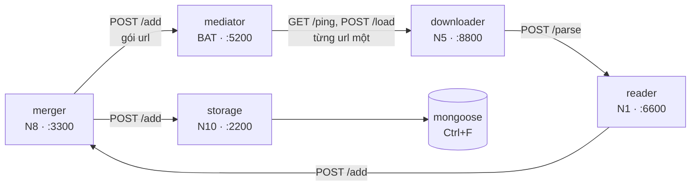

# mediator (Điều khiển, cổng 5200)

**mediator** nhận url từ **merger** (N8), xếp vào hàng đợi rồi đưa **từng url một** cho **downloader** (N5) mỗi khi
downloader rảnh. Nhóm BAT phụ trách và chạy service này cho cả lớp.

Tên các khối:

| Tên | Khối | Nhóm | Cổng |
|---|---|---|---|
| reader | Đọc nội dung | N1 | 6600 |
| downloader | Tải về | N5 | 8800 |
| **mediator** | **Điều khiển** | **BAT** | **5200** |
| merger | Tổng hợp dữ liệu | N8 | 3300 |
| storage | Lưu trữ | N10 | 2200 |
| mongoose | Mongo | Ctrl+F | 27017 |



## Nhóm tôi cần làm gì?

| Nhóm | Cần làm |
|---|---|
| **N8 · merger** | Gửi url vào mediator bằng `POST /add`. Xem [mục 1](#1-n8--merger-gửi-url-vào-mediator). |
| **N5 · downloader** | Làm hai endpoint `GET /ping` và `POST /load` để mediator gọi. Xem [mục 2](#2-n5--downloader-làm-hai-endpoint-cho-mediator-gọi). |
| N1 · reader, N10 · storage, Ctrl+F · mongoose | Không cần làm gì với mediator. Xem [mục 3](#3-reader-storage-mongoose-không-cần-làm-gì). |

Địa chỉ của mediator: `http://<ip-máy-BAT>:5200`. Hỏi nhóm BAT để biết IP.

## 1. N8 · merger: gửi url vào mediator

Chỉ có **một** endpoint:

```
POST http://<ip-máy-BAT>:5200/add
```

Gửi lên một danh sách url:

```json
{"urls": ["https://hust.edu.vn/", "https://hust.edu.vn/tin-tuc1", "https://soict.hust.edu.vn/"]}
```

mediator trả lời **ngay**, không chờ tải xong:

```json
{"accepted": 2, "duplicates": 1, "rejected": 0}
```

- `accepted`: số url mới, đã vào hàng đợi.
- `duplicates`: số url đã gửi trước đó. mediator bỏ qua, không tải thêm lần nữa.
- `rejected`: số chuỗi không phải địa chỉ web (`mailto:`, `ftp:`, sai cú pháp). mediator bỏ qua.

Gửi sai dạng (không phải JSON, hoặc không có `urls`) thì nhận mã `400` kèm `{"error": "<lý do>"}`.

**Thử bằng curl:**

```bash
curl -X POST http://<ip-máy-BAT>:5200/add -d '{"urls": ["https://hust.edu.vn/"]}'
# {"accepted": 1, "duplicates": 0, "rejected": 0}
```

**Ví dụ Python:**

```python
import requests

r = requests.post(
    "http://<ip-máy-BAT>:5200/add", json={"urls": ["https://hust.edu.vn/"]}, timeout=10
)
print(r.json())  # {'accepted': 1, 'duplicates': 0, 'rejected': 0}
```

**Khi nào gửi:**

1. Lúc khởi động: gửi tập url mầm.
2. Mỗi khi nhận kết quả từ reader: lọc link (chỉ giữ miền hust), rồi gửi các url **mới**. Nên gom vài trăm url
   thành một lần gửi thay vì gửi từng url.

**Lưu ý:**

- Gửi trùng không sao, mediator tự bỏ url đã có.
- Không cần gửi lại url cũ để cập nhật nội dung. mediator tự đưa lại url sau 1 ngày (trang chủ), 7 ngày (trang
  thường) hoặc 30 ngày (tài liệu).
- Gửi lỗi (mất kết nối, mã `5xx`) thì thử lại. Url đã gửi thành công được lưu trên đĩa, không mất khi mediator
  khởi động lại.

## 2. N5 · downloader: làm hai endpoint cho mediator gọi

mediator gọi downloader theo hai bước: hỏi **rảnh chưa**, rảnh thì **gửi một url**.

| Endpoint | mediator gửi | downloader phải trả lời |
|---|---|---|
| `GET /ping` | (không có body) | Rảnh: `{"status": "đang chờ"}`<br/>Đang tải: `{"status": "đang bận"}` |
| `POST /load` | `{"url": "https://hust.edu.vn/"}` | Nhận url: mã `202`, `{"status": "đã nhận"}`<br/>Đang bận: mã `409` |

**Bốn quy tắc cần làm đúng:**

1. **Chuỗi trạng thái phải viết đúng, có dấu:** `"đang chờ"`, `"đang bận"`. Viết `"idle"` hay `"dang cho"` thì
   mediator không hiểu và sẽ không gửi url.
2. **`/load` phải trả lời ngay, rồi mới tải.** Nhận url thì trả `202` liền, việc tải chạy ở nền. Nếu tải xong mới
   trả lời, trang nào tải lâu hơn 10 giây sẽ bị mediator tính là lỗi.
3. **Mỗi lúc chỉ tải một url.** Đang tải thì `/ping` trả `"đang bận"` và `/load` trả `409`. Tải xong thì `/ping`
   trả lại `"đang chờ"` để nhận url tiếp theo.
4. **Tải xong thì gửi thẳng sang reader** (`POST http://<ip-N1>:6600/parse`). Không gửi gì về mediator.

Nếu downloader không trả lời `/ping` trong 2 giây, mediator chờ 30 giây rồi mới hỏi lại. Url vẫn nằm trong hàng
đợi, không mất.

**Tự kiểm tra trước khi ghép:**

```bash
curl http://localhost:8800/ping
# {"status": "đang chờ"}
curl -i -X POST http://localhost:8800/load -d '{"url": "https://hust.edu.vn/"}'
# HTTP/1.1 202 Accepted ...      (phải trả về ngay)
curl http://localhost:8800/ping
# {"status": "đang bận"}         (trong lúc đang tải)
```

**Code mẫu:** [`demo/fake_fetcher.py`](demo/fake_fetcher.py) (khoảng 50 dòng) trả lời đúng hai endpoint trên,
chỉ ghi log url nhận được chứ không tải. Có thể lấy làm khung rồi thêm phần tải trang và gửi sang reader.

**Để ghép:** gửi cho nhóm BAT địa chỉ của downloader, dạng `http://<ip>:8800`. Máy chạy downloader phải mở cổng
8800 để máy BAT gọi được (cùng mạng LAN, tường lửa không chặn).

## 3. reader, storage, mongoose: không cần làm gì

mediator không gọi các khối này, và các khối này cũng không gọi mediator. Chỉ cần biết hai điều:

- Dữ liệu tới reader là do **downloader** gửi, không phải mediator.
- mediator đưa lại mỗi url theo chu kỳ để cập nhật nội dung, nên **cùng một url sẽ đi qua nhiều lần**. storage nên
  ghi đè theo `url` thay vì thêm bản ghi mới.

## 4. mediator xử lý url thế nào

- **Bỏ trùng:** chuẩn hoá url trước khi lưu. Ví dụ `HTTPS://Hust.edu.vn/?utm_source=fb` và `https://hust.edu.vn/`
  được coi là một url.
- **Không dồn tải vào một website:** hai lần gửi url của cùng một website cách nhau ít nhất 1 giây. Trong lúc chờ,
  url của website khác vẫn được gửi.
- **Cập nhật định kỳ:** url đã tải được đưa lại sau 1 ngày (trang chủ), 7 ngày (trang thường) hoặc 30 ngày (tài
  liệu: `.pdf`, `.docx`, `.xlsx`, ...).
- **Thử lại khi lỗi:** gửi lỗi thì url được thử lại. Lỗi 5 lần liền thì tạm bỏ, đến chu kỳ sau mới thử lại.

mediator **không** tải trang, **không** lọc miền hust (việc của merger) và **không** nhận kết quả tải.

## 5. Nhóm BAT: chạy mediator

Cần Docker. Trong thư mục `mediator/`:

1. Điền địa chỉ downloader (N5 gửi) vào `config/controller.yaml`:

   ```yaml
   downloaders:
     - http://<ip-N5>:8800        # downloader chạy trên cùng máy với mediator: http://host.docker.internal:8800
   ```

2. Build và chạy:

   ```bash
   docker compose up -d --build
   docker compose ps                  # mediator phải ở trạng thái healthy
   ```

3. Kiểm tra:

   ```bash
   curl -X POST localhost:5200/add -d '{"urls": ["https://hust.edu.vn/"]}'
   # {"accepted": 1, "duplicates": 0, "rejected": 0}
   docker compose logs -f mediator    # thấy dòng: load https://hust.edu.vn/ -> http://<ip-N5>:8800: ok
   ```

Các lệnh khác:

```bash
docker compose restart mediator       # sau khi sửa config/controller.yaml (hàng đợi giữ nguyên)
docker compose up -d --build          # sau khi sửa code
docker compose down                   # dừng; hàng đợi vẫn còn
docker compose down -v                # dừng và xoá luôn hàng đợi
```

Mở cổng 5200 trên máy BAT để merger gửi url tới được.

**Thử trên một máy, không cần Docker và không cần N5** (mỗi lệnh một terminal, downloader giả lập đứng thay N5):

```bash
uv sync
uv run python -m demo.fake_fetcher --port 8800
uv run mediator serve --config config/controller.local.yaml
```

Log của mediator ghi từng lần gửi (`load <url> -> <downloader>: ok`). Cứ 30 giây mediator in một dòng tóm tắt
`controller: <n> urls, <n> due, <n>/<n> nodes resting`: tổng số url, số url đến hạn, downloader có đang bị tạm
ngừng hỏi không.

### Cấu hình (`config/controller.yaml`)

| Khoá | Mặc định | Ý nghĩa |
|---|---|---|
| `port` | 5200 | cổng nhận `/add` |
| `downloaders` | (bắt buộc) | địa chỉ downloader, vd. `[http://10.0.0.11:8800]`; ghi nhiều địa chỉ thì mediator chia url xoay vòng |
| `host_delay_seconds` | 1.0 | khoảng cách tối thiểu giữa hai lần gửi url của cùng một website |
| `ping_timeout_seconds` | 2 | thời gian chờ `/ping` |
| `load_timeout_seconds` | 10 | thời gian chờ `/load` |
| `node_cooldown_seconds` | 30 | downloader không trả lời thì chừng này giây sau mới hỏi lại |
| `max_attempts` | 5 | số lần lỗi liền trước khi tạm bỏ url đến chu kỳ sau |
| `tick_seconds` | 0.5 | nhịp kiểm tra lại khi chưa có gì để gửi |
| `recrawl_days` | `{hub: 1, page: 7, document: 30}` | chu kỳ đưa lại url (ngày); `0` là không đưa lại |
| `database` | (bắt buộc) | tệp SQLite chứa hàng đợi |

`config/controller.local.yaml` là bản để chạy không cần Docker. Cấu hình sai thì service in lý do và không khởi
động.

### Phát triển

```bash
uv sync
uv run pytest -q
uv run ruff check . && uv run ruff format --check .
uv run pyrefly check
```
