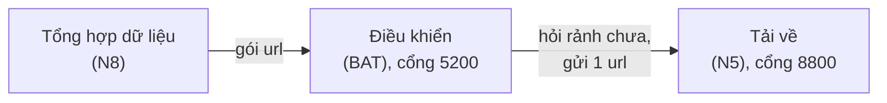
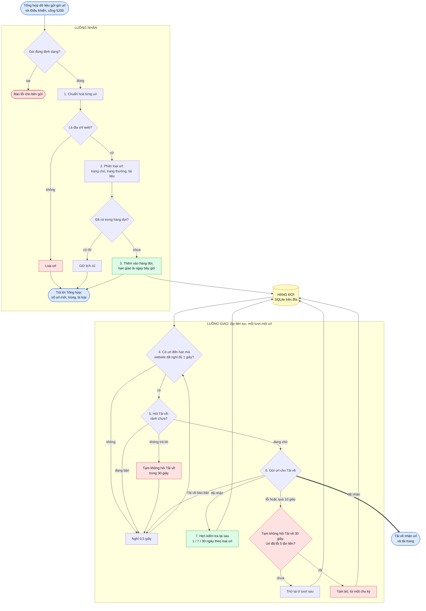

# Điều khiển: luồng xử lý và công nghệ

Tài liệu mô tả service Điều khiển (khối 3 trong slide) làm việc như thế nào: url đi qua những bước nào, mỗi bước
xử lý ra sao và dùng công nghệ gì. Cách các nhóm khác nối với Điều khiển nằm ở [README](../README.md).

## 1. Vai trò trong hệ thống

Điều khiển đứng giữa khối Tổng hợp dữ liệu và service Tải về:

- **Đầu vào:** Tổng hợp gửi gói url cần thu thập vào cổng 5200.
- **Xử lý:** lưu url vào hàng đợi, bỏ trùng, giãn cách các lần gửi vào cùng một website, chờ Tải về rảnh mới giao,
  hẹn ngày kiểm tra lại.
- **Đầu ra:** gửi từng url một tới service Tải về.

Điều khiển không tải trang và không đọc nội dung. Nó chỉ quyết định **url nào** được gửi và **lúc nào** gửi.

Service Tải về chỉ tải **một url một lúc**: đang tải thì báo "đang bận", tải xong thì báo "đang chờ". Vì vậy Điều
khiển phải giữ url trong hàng đợi và đưa từng url một, đúng lúc Tải về rảnh. Nếu Tổng hợp gửi thẳng cho Tải về thì
Tải về sẽ bị dồn hàng nghìn url cùng lúc.

## 2. Công nghệ

| Công nghệ | Dùng làm gì | Vì sao chọn |
|---|---|---|
| Python 3.13 | ngôn ngữ viết service | cùng ngôn ngữ với phần còn lại của nhóm |
| `asyncio` | một tiến trình vừa nhận url vừa giao url song song | chờ mạng (hỏi Tải về, gửi url) không làm chậm việc nhận url |
| `aiohttp` | HTTP server để nhận url, HTTP client để gọi Tải về | một thư viện bất đồng bộ dùng được cho cả hai chiều |
| SQLite | hàng đợi url, lưu trên đĩa | có sẵn trong Python, không cần cài server cơ sở dữ liệu; tắt máy không mất url |
| YAML | tệp cấu hình (địa chỉ Tải về, thời gian chờ, chu kỳ kiểm tra lại) | dễ đọc, viết được chú thích |
| Docker, Docker Compose | đóng gói và chạy service | chạy bằng một lệnh trên mọi máy |
| `uv` | cài thư viện đúng phiên bản đã khoá | mọi máy chạy cùng một bộ thư viện |
| pytest | kiểm thử tự động | chứng minh thời gian chờ, lập lịch, xử lý Tải về lỗi chạy đúng |

## 3. Luồng xử lý tổng thể

Service có hai luồng chạy song song, gặp nhau ở hàng đợi:

1. **Luồng nhận:** Tổng hợp gửi url tới, Điều khiển làm sạch url rồi cất vào hàng đợi. Trả lời ngay, không chờ tải.
2. **Luồng giao:** một vòng lặp chạy liên tục, mỗi lượt lấy một url đến hạn ra khỏi hàng đợi và giao cho Tải về
   khi Tải về rảnh.

Sơ đồ dưới đây đi từ lúc Tổng hợp gửi url tới lúc url đến tay Tải về. Các bước đánh số từ 1 đến 7; mục 4 và 5 giải
thích chi tiết từng bước.

Đọc sơ đồ:

- **Xanh dương:** chỗ Điều khiển nói chuyện với khối khác (Tổng hợp gửi vào, Tải về nhận ra).
- **Vàng:** hàng đợi, nơi hai luồng gặp nhau. Mọi url, kể cả url cần thử lại hay cần kiểm tra lại, đều quay về đây.
- **Xanh lá:** bước thành công. **Đỏ:** url bị loại, Tải về không trả lời hoặc url bị lùi lịch.
- Mọi nhánh "chưa giao được" (Tải về bận, không trả lời, hết url đến hạn) đều về ô **Nghỉ 0,5 giây**. Url vẫn nằm
  trong hàng đợi và được thử lại ở lượt sau.

Nhờ tách hai luồng, Tổng hợp gửi bao nhiêu url cũng được trả lời ngay; tốc độ giao do tốc độ tải của Tải về quyết
định.

## 4. Luồng nhận url

### 4.1. Nhận gói url

Tổng hợp gửi một gói url dạng JSON. Điều khiển kiểm tra gói có đúng dạng không (sai thì báo lỗi ngay), xử lý từng
url qua các bước dưới, rồi trả về ba con số: bao nhiêu url **mới**, bao nhiêu url **trùng** (đã có trong hàng đợi),
bao nhiêu url **bị loại** (không phải địa chỉ web). Url mới được giao ngay khi Tải về rảnh.

### 4.2. Chuẩn hoá url

Cùng một trang có thể được viết theo nhiều kiểu. Điều khiển đưa mọi cách viết về một dạng duy nhất để không tải
một trang hai lần:

- viết thường tên miền, bỏ cổng mặc định, bỏ phần `#...` ở cuối;
- bỏ tham số theo dõi quảng cáo (`utm_*`, `fbclid`, ...) và tham số phiên đăng nhập;
- sắp xếp các tham số còn lại theo thứ tự cố định.

Ví dụ: `HTTPS://Hust.edu.vn:443/a/../b?z=2&a=1&utm_source=fb#top` thành `https://hust.edu.vn/b?a=1&z=2`.

Những chuỗi không phải trang web (`mailto:`, `ftp:`, url chứa mật khẩu, url hỏng) bị loại.

### 4.3. Phân loại url

Mỗi url được gán một trong ba loại, vì mỗi loại thay đổi với tốc độ khác nhau:

| Loại | Nhận biết | Kiểm tra lại sau |
|---|---|---|
| Trang chủ | đường dẫn rỗng hoặc `/` | 1 ngày (tin mới đăng liên tục) |
| Trang thường | còn lại | 7 ngày |
| Tài liệu | đuôi `.pdf`, `.docx`, `.xlsx`, `.pptx`, `.zip`, ... | 30 ngày (hiếm khi đổi) |

Các chu kỳ này chỉnh được trong tệp cấu hình.

### 4.4. Hàng đợi

Hàng đợi lưu mọi url đã biết, mỗi url kèm: loại, **hạn giao kế tiếp**, số lần gửi lỗi liền. Ngoài ra lưu thời điểm
lần cuối gửi url của **từng website**, để tính thời gian chờ ở bước sau.

Hàng đợi nằm trong một tệp SQLite trên đĩa. Url đã có trong hàng đợi thì giữ nguyên lịch cũ, nên Tổng hợp gửi lại
url cũ không làm url đó bị tải thêm lần nữa. Tắt service rồi bật lại, việc giao url chạy tiếp đúng chỗ.

## 5. Luồng giao url

Vòng giao chạy liên tục. Mỗi lượt giao **tối đa một url**. Giao được thì lượt sau chạy ngay; chưa giao được thì
nghỉ nửa giây rồi thử lại, nên lúc rảnh service gần như không tốn CPU.

Các bước 4 đến 7 trong sơ đồ ở mục 3 chính là một lượt giao.

### 5.1. Thời gian chờ theo website

Hai lần gửi url của cùng một website cách nhau ít nhất 1 giây (chỉnh được). Mục đích là thu thập "lịch sự": không
dồn dập vào một website của trường, tránh làm quá tải hoặc bị chặn.

Khi chọn url, Điều khiển bỏ qua các website chưa nghỉ đủ và lấy url của website khác. Vì vậy trong lúc một website
đang nghỉ, các website khác vẫn được thu thập, và nhiều website được thu thập xen kẽ nhau.

### 5.2. Gửi url cho Tải về

Giao tiếp với Tải về theo giao thức trong slide, qua HTTP. Trước khi gửi, Điều khiển luôn hỏi Tải về có rảnh không:

| Bước | Tải về trả lời | Điều khiển làm gì |
|---|---|---|
| Hỏi "rảnh chưa?" | "đang chờ" | gửi url |
| Hỏi "rảnh chưa?" | "đang bận" | để url lại, nghỉ 0,5 giây rồi hỏi lại |
| Hỏi "rảnh chưa?" | không trả lời trong 2 giây, hoặc trả sai | coi như Tải về đang hỏng, 30 giây sau mới hỏi lại |
| Gửi url | đã nhận | giao xong, hẹn ngày kiểm tra lại |
| Gửi url | bận (mã 409) | để url lại, hỏi lại ở lượt sau |
| Gửi url | lỗi, không trả lời trong 10 giây | 30 giây sau mới hỏi lại, url được thử lại sau |

Việc tạm ngừng 30 giây khi Tải về hỏng giúp Điều khiển không gọi liên tục vào một service đang chết. Khi Tải về
chạy lại, việc giao url tự tiếp tục, không phải khởi động lại Điều khiển.

### 5.3. Lập lịch lại

Sau mỗi lần gửi, Điều khiển tính lại hạn giao kế tiếp của url:

| Tình huống | Hạn giao kế tiếp |
|---|---|
| Tải về nhận url | sau một chu kỳ theo loại url (1, 7 hoặc 30 ngày) để kiểm tra nội dung mới |
| Gửi lỗi, chưa quá 5 lần liền | ngay lượt sau |
| Gửi lỗi lần thứ 5 liền | tạm bỏ, lùi một chu kỳ rồi mới thử lại |

Nhờ vậy trang đã thu thập tự được kiểm tra lại định kỳ, còn url hỏng được thử lại vài lần nhưng không lặp mãi.

## 6. Xử lý lỗi

| Tình huống | Điều khiển làm gì |
|---|---|
| Gói url gửi tới sai định dạng | báo lỗi cho bên gửi |
| Url không phải địa chỉ web | đếm vào số url bị loại, bỏ qua |
| Tải về bận | url nằm chờ trong hàng đợi, hỏi lại sau 0,5 giây |
| Tải về không trả lời | 30 giây sau mới hỏi lại |
| Gửi url lỗi hoặc quá hạn | 30 giây sau mới hỏi lại Tải về, url được thử lại |
| Url lỗi 5 lần liền | lùi một chu kỳ, ghi log |
| Cấu hình sai | báo lý do và không khởi động |
| Tắt service giữa chừng | hàng đợi còn trên đĩa; bật lại thì chạy tiếp |

## 7. Triển khai

- Service được đóng thành một image Docker và chạy bằng Docker Compose. Hàng đợi nằm trên một volume, nên xoá
  container không mất url.
- Địa chỉ Tải về, thời gian chờ, chu kỳ kiểm tra lại đều nằm trong một tệp cấu hình YAML.
- Khi ghép với các nhóm, chỉ cần điền địa chỉ Tải về của nhóm N5 vào tệp cấu hình; nhóm N8 gửi url tới cổng
  5200 của máy chạy Điều khiển.
- Kèm theo là một **Tải về giả lập** (không chạy trong Docker): trả lời đúng giao thức, chỉ ghi log url nhận được,
  không tải gì. Nó dùng để kiểm thử và thử Điều khiển trên một máy. Nhóm Tải về cũng dùng nó làm code mẫu.
- Mỗi 30 giây service in một dòng tóm tắt: tổng số url, số url đến hạn, Tải về có đang bị tạm ngừng hỏi không.
- Kiểm thử tự động bằng pytest: kiểm tra riêng từng bước (chuẩn hoá, thời gian chờ, lập lịch lại, Tải về bận hoặc
  hỏng) và chạy cả service thật với Tải về giả lập qua HTTP.
- Tệp cấu hình nhận một **danh sách** địa chỉ Tải về. Hiện chỉ có một service nên danh sách có một dòng. Nếu sau
  này chạy thêm bản Tải về thứ hai, chỉ cần thêm một dòng: Điều khiển sẽ tự chia url lần lượt cho từng bản (xoay
  vòng), không phải sửa code.
